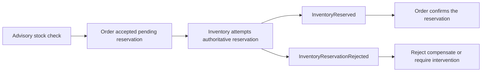

# Validation authority

Portia allows cross-aggregate reads for proactive validation. Their value is an earlier, clearer
response and less avoidable work. Their success cannot establish an invariant across independently
committed aggregate streams.

The same distinction applies to a Cassie projection, a directly loaded aggregate, and an external
system lookup: a fresh observation can become false before the consuming operation commits.
Authority comes from the participant's atomic decision and committed outcome.

## Three validation roles

| Role | Responsibility | Guarantee |
| --- | --- | --- |
| Local validation | The aggregate enforces its own rules during command processing and commit. | Only the invariants inside that aggregate's atomic consistency boundary. |
| Advisory validation | Cross-aggregate or external reads reject obviously invalid work early. | An observation that can improve efficiency and user experience. |
| Outcome validation | Choreography asks the owning participants to reserve, accept, or reject work and consumes their committed outcomes. | Authoritative confirmation or rejection of the cross-aggregate business assumptions. |

**A successful advisory check must never eliminate the need for authoritative outcome validation.**

Advisory reads may live in guards, handlers, or aggregate/application behavior as appropriate to
the feature. Their location does not make them authoritative. Preserve the ordinary aggregate
command, optimistic concurrency, authorization, and event-attribution boundaries.

## Order placement

An Order checks Inventory and observes sufficient stock. It may accept the placement into an
explicit pending state. The observation is useful even though Inventory can change before a
reservation is committed.

Inventory enforces its capacity invariant atomically and commits either the reservation or an
explicit rejection outcome. The choreography consumes that fact and advances the Order through
its own authoritative command. Other requirements, such as payment authorization, also need their
own authoritative outcomes before the business operation can be called complete.

A timeout or missing response is an unknown outcome, rather than proof that the reservation failed.
Reconcile the recorded participant outcome using the stable business operation identity. Replayed
commands and events must preserve the same reservation/effect identity and tolerate duplicates.

## Explicit resolution

Every workflow that relies on cross-aggregate assumptions defines the consequences of failed
outcome validation:

- Reject the operation when it has no committed effects requiring reversal.
- Compensate completed effects through explicit participant commands and their outcomes.
- Flag the operation for intervention when automatic resolution is unavailable or exhausted.

Keep pending, compensation, unknown, and intervention states visible in the business model as
appropriate. A compensation request is not proof that compensation completed. Completion requires
the corresponding authoritative outcome.

## Processing failures and business outcomes

Framework retry policy answers whether an event's processing should be attempted again. It does
not decide whether the business operation succeeded or failed.

A reactor that receives `InventoryReservationRejected` can successfully process that fact by
issuing the appropriate Order rejection or compensation command. Once its required durable work
has succeeded, it returns `Result.Success`, allowing its checkpoint to advance. The business
operation can be rejected while processing that rejection succeeds.

Return a failed `Result`, or propagate an exception, when the reaction's required work remains
incomplete. Transient failures receive bounded retries; permanent failures stop the worker with
a diagnostic. Neither a retry nor a terminal worker fault substitutes for the workflow's required
business resolution. Application-owned reconciliation and intervention behavior must account for
unresolved operations.

Projectors turn committed outcomes into read models. Reactors and commands implement the
choreography; projection freshness and repeated advisory reads cannot replace participant decisions.

## Implementation and review

For each cross-aggregate business requirement, identify the local consistency boundaries, the
advisory observation, the participant command that obtains authority, and the events that confirm
or reject it. Define the parent operation's pending and terminal states and its rejection,
compensation, or intervention path.

Tests must include an advisory check that passes followed by a participant rejection, duplicate
and reordered deliveries where supported, retry/unknown-outcome recovery, and incomplete or failed
compensation. Verify that no successful advisory read alone can mark the business operation complete.
